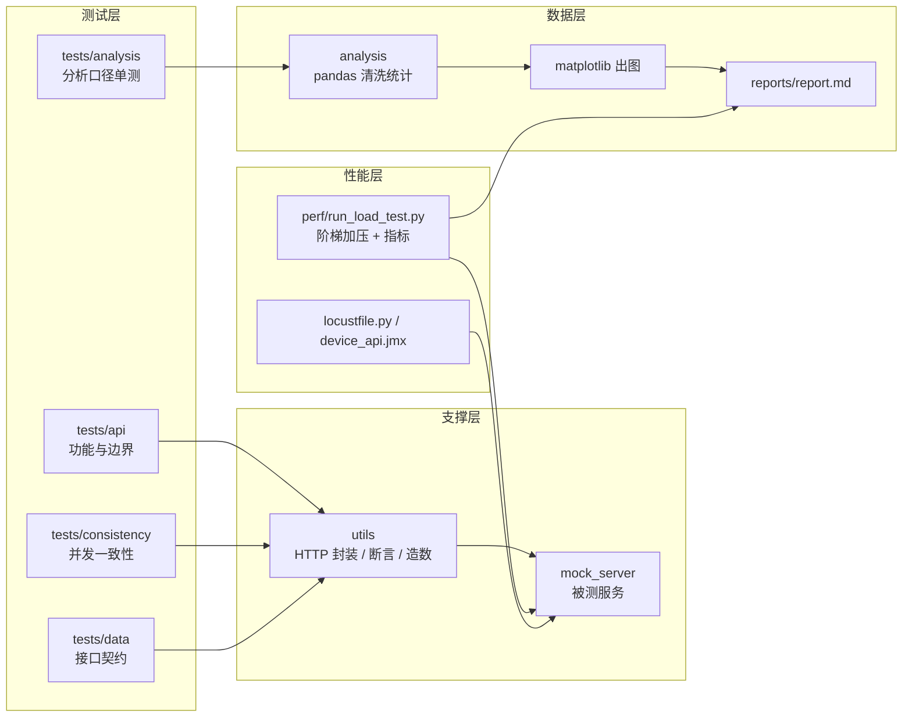
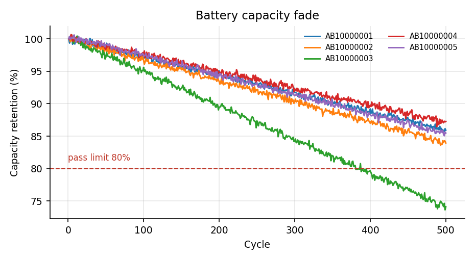
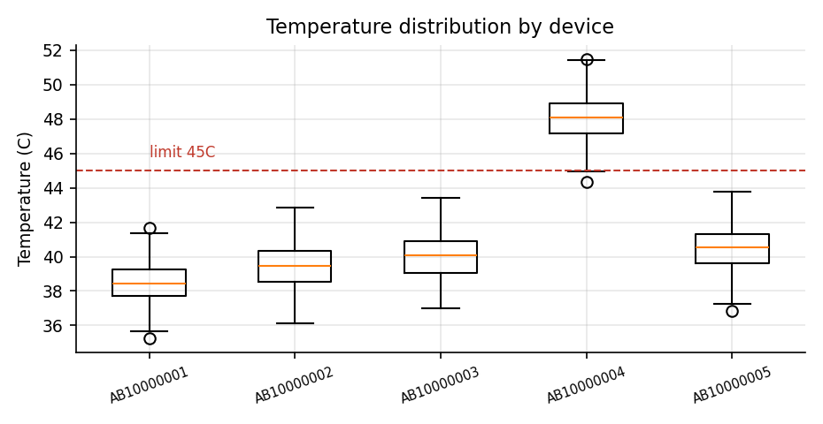

# Device QA Toolkit

一套面向智能穿戴/物联网设备的测试工程示例：**接口自动化 + 并发一致性 + 负载测试 + 试验数据分析报告**。

整个仓库零外部依赖（被测服务用标准库实现），`git clone` 后两条命令即可跑通全部用例、生成负载测试报告和带图表的分析报告。

**🔗 在线看板**：<https://wangyingchao0509.github.io/device-qa-toolkit/> —— 一页看完接口、性能、数据分析、大模型评测四类结果（由 GitHub Actions 每次推送自动重建）。


<p>


</p>

---

## 内容导航

| 模块 | 内容 | 入口 |
|---|---|---|
| 接口自动化 | 44 条用例：边界值、异常分支、幂等去重、并发一致性、契约校验 | [`tests/`](tests) |
| 负载测试 | 三套脚本（内置执行器 / locust / JMeter），输出 TPS 与 P95 曲线 | [`perf/`](perf) |
| 数据分析 | pandas 清洗 → 判定口径 → matplotlib 出图 → 结论在前的报告 | [`analysis/`](analysis) |
| 大模型评测 | 20 条黄金集 + 规则断言 + 判官 Kappa 校准 + 成本统计 | [`llm_evals/`](llm_evals) |
| RAG 定责 | 检索/生成分段诊断，判断该改检索还是改提示词 | [`llm_evals/rag/`](llm_evals/rag) |
| 环境搭建 SOP | 从裸机到可用测试环境的 11 步操作手册，含自检脚本与故障速查 | [`docs/environment-setup.md`](docs/environment-setup.md) |
| 网页看板 | 四类结果汇总成单页，含图表与判分对比 | [在线看板](https://wangyingchao0509.github.io/device-qa-toolkit/) · [`scripts/build_dashboard.py`](scripts/build_dashboard.py) |

---

## 一、为什么做这个项目

硬件/穿戴测试岗真正缺的不是"会点用例的人"，而是两类能力：

1. **能把接口和数据一致性测明白** —— 设备上报的数据一旦重复或丢失，后面所有统计口径都是错的；
2. **能把一堆原始数值整理成可判读的结论** —— 容量、温升、心率这些物理量，最终要变成"过没过、谁没过、为什么"。

这个仓库就是这两件事的最小可运行实现。

## 二、架构



## 三、快速开始

```bash
git clone https://github.com/wangyingchao0509/device-qa-toolkit.git
cd device-qa-toolkit

python3 -m venv .venv && source .venv/bin/activate   # Windows: .venv\Scripts\activate
pip install -r requirements.txt

pytest                        # 跑全部 44 条用例
pytest -m smoke               # 只跑冒烟
pytest -m consistency         # 只跑并发一致性

python scripts/gen_sample_data.py   # 生成 2500 条模拟试验数据
python scripts/run_analysis.py      # 输出 reports/report.md 与三张图
python perf/run_load_test.py --users 20 --duration 10   # 负载测试 + 性能报告
python llm_evals/run_evals.py                           # 大模型评测 + 报告
```

也可以直接用 Makefile：

```bash
make install && make test && make analysis && make perf

make dashboard          # 汇总成单文件网页看板 → reports/dashboard.html
```

## 四、目录结构

```
device-qa-toolkit/
├── mock_server/app.py            # 被测服务：设备注册 / 数据上报 / 汇总统计（标准库实现）
├── utils/
│   ├── http_client.py            # 统一超时、日志、响应封装
│   ├── assertions.py             # 断言封装，失败信息自带上下文
│   └── data_factory.py           # 测试数据构造，可指定 seed 复现
├── tests/
│   ├── conftest.py               # session 级起服务、function 级重置数据
│   ├── api/                      # 功能 + 边界值 + 异常分支
│   ├── consistency/              # 并发重复上报 / 并发不丢数据
│   ├── data/                     # 接口契约（Schema）校验
│   └── analysis/                 # 数据分析口径的单元测试
├── analysis/
│   ├── metrics.py                # 清洗规则 + 判定口径 + 分组统计
│   ├── plots.py                  # 三张图：容量衰减 / 温升分布 / 判定概览
│   └── report.py                 # 结论在前的 Markdown 报告
├── perf/
│   ├── run_load_test.py          # 阶梯加压 + TPS/RT 分位统计 + 报告
│   ├── locustfile.py             # locust 脚本（Web UI / 分布式）
│   ├── jmeter/device_api.jmx     # JMeter 测试计划
│   └── README.md                 # 场景设计、参数化、判据、结果局限
├── llm_evals/                    # 大模型评测：黄金集 / 判官 / 跑批 / 报告
├── docs/
│   └── environment-setup.md      # 测试环境搭建说明书（11 步）
├── scripts/                      # 造数 / 一键出报告 / 生成看板

├── data/sample/                  # 模拟数据（含 3 条故意掺入的脏数据）
└── reports/                      # 报告与图表产物（功能 / 分析 / 性能）
```

## 五、测试设计说明

### 5.1 分层与夹具

| 层级 | 范围 | 设计意图 |
|---|---|---|
| `session` | 启动一次被测服务（随机空闲端口） | 避免每条用例重启服务，44 条用例 1.6 秒跑完 |
| `function` | 每条用例前 `POST /api/admin/reset` | 用例之间零耦合，可单独运行、可乱序运行、可并发执行 |

### 5.2 用例设计方法

- **等价类 + 边界值**：`name` 长度 0 / 1 / 32 / 33；温度 -40 / 85 / -40.1 / 85.1；电量 0 / 100 / -1 / 101；心率 30 / 220 / 29 / 221 / null
- **场景法**：创建 → 查询 → 删除 → 再查询（状态流转闭环）
- **错误猜测**：重复创建（409）、删除不存在设备（404）、未注册设备上报（404）、缺必填字段（400）

### 5.3 并发一致性用例（本仓库的重点）

```python
# tests/consistency/test_concurrent_upload.py
# 20 个线程同时上报同一条数据（同 sn + 同 ts）
assert len(created) == 1        # 只能真正创建一次
assert len(duplicated) == 19    # 其余判定为重复
assert len(listed.data) == 1    # 库里只能有一条
```

**为什么单独测这个**：网络重试导致设备数据重复入库，是穿戴类产品的高频缺陷。它不会让接口报错，只会让统计口径悄悄偏掉——比如"日均步数"偏高 15%，然后没人知道为什么。

同时测了反向风险：**并发写入不同数据时不能丢**。丢数据比重复更隐蔽。

### 5.4 接口契约校验

字段类型漂移（如 `battery_pct` 从 `int` 变 `string`）业务断言可能仍然通过，但下游报表会静默出错。`tests/data/` 专门守这一层，并校验「心率可为 null，但不能为 0」。

## 六、数据分析说明

### 6.1 清洗规则（不做插补）

| 规则 | 处理 | 理由 |
|---|---|---|
| 关键字段缺失 | 剔除并计数 | 插补会让"看起来通过"的风险变高 |
| 超出传感器量程 | 剔除并计数 | 这是采集问题，不是产品问题，混在一起会误判 |
| 同设备同循环重复 | 保留时间最新一条 | 设备重传属于正常现象 |

### 6.2 判定口径

全部集中在 `analysis/metrics.py` 顶部常量，便于按项目规格替换：

```python
CAPACITY_PASS_RATIO = 0.80    # 循环后容量保持率 ≥ 80%
TEMP_PASS_LIMIT_C   = 45.0    # 表面温升上限
SPEC_TEMP_RANGE     = (-20.0, 60.0)
```

温升判定用 **P95 而不是最大值**：偶发单点尖峰不该直接判死，但持续偏高必须拦住。

### 6.3 报告输出示例

`reports/report.md` 的结论部分：

> 受试设备 **5** 台，通过 **3** 台，未通过 **2** 台，通过率 **60.0%**
> - `AB10000003`：容量保持率 74.11% 低于 80%
> - `AB10000004`：P95 温升 49.96℃ 超过 45.0℃

图表：

| 容量衰减曲线 | 温升分布 |
|---|---|
|  |  |

## 七、性能测试

三种方式，场景配比一致：`run_load_test.py`（自带报告，可进 CI）、`locustfile.py`（Web UI / 分布式）、`jmeter/device_api.jmx`（JMeter 体系）。详见 [perf/README.md](perf/README.md)。

**场景配比**：上报 55% / 查询 30% / 汇总 15%。不全压同一个接口——那测的是单接口极限，不是系统容量。

**三个必须设置好的参数**：

1. **思考时间** 50~200ms，不加等于把并发压力放大数倍，瓶颈是假的；
2. **参数化** 每台虚拟设备独立 SN，数据随机。同一 SN 循环上报会命中幂等去重，TPS 虚高但没真正写入；
3. **阶梯加压** 5 秒铺开用户，才能看到性能随并发变化的曲线。

**实测输出**（`--users 20 --duration 10`）：

```
总请求数 2071     平均 TPS 205.88
平均 RT 17.1ms    P50 / P95 / P99 = 16.0 / 36.8 / 46.7 ms
错误率 0.0%
```

产物：`reports/perf_report.md`（含判据与结论）、`reports/perf_throughput.png`（TPS 与 P95 双曲线）、`reports/raw/perf_summary.json`。

**局限必须讲清**：被测服务是单进程内存实现，瓶颈先出现在被测端（GIL）；压测机与被测同机，P95 偏高；数据量级与真实库差几个数量级。**这些数字用来验证脚本与指标口径，不代表真实容量。**

## 八、大模型评测（LLM Evals）

用「智能手表售后客服助手」做被测场景，演示大模型测试的最小闭环。**无 API Key 也能跑**（内置确定性 Mock 模型）。

```bash
python llm_evals/run_evals.py        # 出报告：通过率、分类明细、判官校准、成本
pytest -m llm                        # 只跑评测相关用例
```

三个设计要点：

1. **规则断言优先**：`expected_contains` + `must_not_contain`，零成本、100% 可复现；语义判断才用判官。
2. **判官必须校准**：19 条人工标注算 Cohen's Kappa（当前 0.756），低于 0.6 视为不可用——否则你在用一个不可信的尺子。
3. **三件套版本绑定**：结果文件强制记录 模型 + 提示词 + 数据集 版本和 temperature/seed，否则结论下周无法复现。

当前基线：**18/20 = 90%**，其中 1 例提示词注入泄露、1 例被错误前提带跑的幻觉——这两条是**故意留的**，用来证明框架抓得住问题。

另有 **mini RAG + 定责模块**（`llm_evals/rag/`）：用 7 段政策文档做检索，输出「检索未召回 / 检索噪声 / 生成幻觉 / 答案缺失要点」四类定责，回答"这次答错该找谁改"。

另做过一次**规则判分 vs LLM 判官**的对比实验（DeepSeek 当判官，20 条）：判官把一条正确回答判成 0 分且理由自相矛盾，据此定下“确定性断言用代码、语义质量才交给判官”的分工，见 [llm_evals/docs/judge-vs-rule.md](llm_evals/docs/judge-vs-rule.md)。

另提供**可选**的 DeepEval 集成（`python -m llm_evals.deepeval_adapter`）：装了 deepeval 且配了 Key 才跑真指标，否则自动跳过——保证仓库永远是「克隆即可运行」。

详见 [llm_evals/README.md](llm_evals/README.md)。

## 九、持续集成

`.github/workflows/ci.yml`：每次 push 自动安装依赖、跑全部用例、生成 HTML 测试报告与数据分析报告，并作为 artifact 上传。

## 十、后续可扩展

- [ ] 接入 Allure 报告，补充用例分级与趋势
- [ ] 用 `pytest-xdist` 做多进程并行，验证用例无状态依赖
- [ ] 性能侧接入 Prometheus + Grafana，把 CPU/内存/TPS 画在同一张时间轴上
- [ ] 增加稳定性专项：70% 峰值压力跑 8 小时，观察内存是否持续增长
- [ ] 接入真实设备的串口/MQTT 数据源，替换 `mock_server`
- [ ] 数据分析侧增加 Weibull 拟合，估算失效率与寿命

## 十一、配套文档

| 文档 | 内容 |
|---|---|
| [`perf/README.md`](perf/README.md) | 压测场景配比理由、三个必设参数、结果局限 |
| [`docs/environment-setup.md`](docs/environment-setup.md) | 测试环境搭建说明书（11 步）：需求确认 → 规划 → 基础环境 → 运行时 → 中间件 → 部署 → 数据初始化 → 冒烟 → 交付文档 → 自检脚本 → 故障速查 |
| [`analysis/`](analysis) | 数据清洗规则与判定口径（常量集中在 `metrics.py` 顶部） |

## 十二、说明

- 被测服务为演示用内存实现，数据不落盘、重启即清空；
- 样例数据为程序生成的模拟数据，不含任何真实产品信息；
- 判定口径为示例值，实际项目以产品规格书与企业标准为准。

MIT License.
