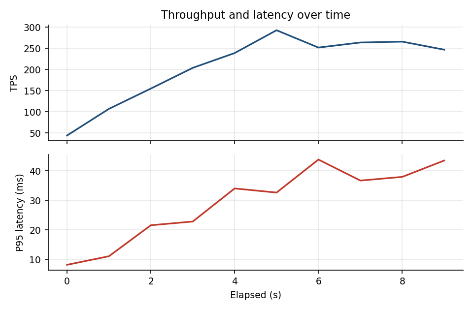

# 负载测试报告

## 一、测试条件

- 虚拟用户：**20**，加压窗口 5 秒，持续 10.1 秒
- 思考时间：0.05 秒（不加思考时间等于把并发压力放大数倍，结论会失真）
- 场景配比：上报数据 55% / 查询数据 30% / 查询汇总 15%
- 被测服务：仓库内置 Mock 服务（内存实现，非真实后端，瓶颈可能先出现在被测端）

## 二、总体结果

| 指标 | 数值 |
|---|---|
| 总请求数 | 2071 |
| 平均 TPS | 205.88 |
| 平均响应时间 | 17.1 ms |
| P50 / P95 / P99 | 16.0 / 36.8 / 46.7 ms |
| 最大响应时间 | 54.0 ms |
| 错误率 | 0.0% |

## 三、分场景

| 场景 | 请求数 | 平均 RT | P95 RT | 错误率 |
|---|---|---|---|---|
| 上报数据 | 1089 | 17.2 | 37.6 | 0.0% |
| 查询数据 | 639 | 17.0 | 36.5 | 0.0% |
| 查询汇总 | 343 | 17.1 | 35.1 | 0.0% |

## 四、曲线

## 五、判据与结论

| 判据 | 阈值 | 实际 | 结论 |
|---|---|---|---|
| 错误率 | ≤ 0.1% | 0.0% | PASS |
| P95 响应时间 | ≤ 500 ms | 36.8 ms | PASS |

> 说明：本仓库的 Mock 服务为单进程内存实现，CPU 与 GIL 是主要瓶颈。
> 该结果用于验证压测脚本与指标口径，不代表真实后端容量。
