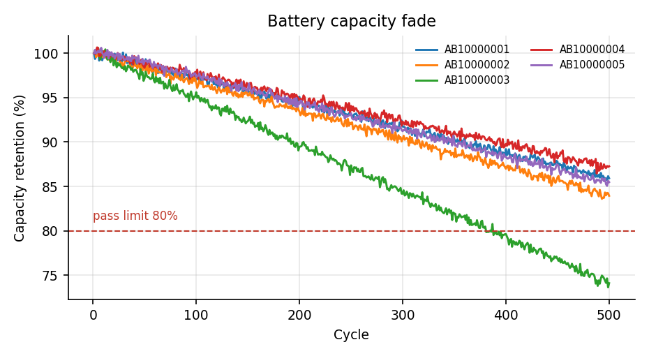
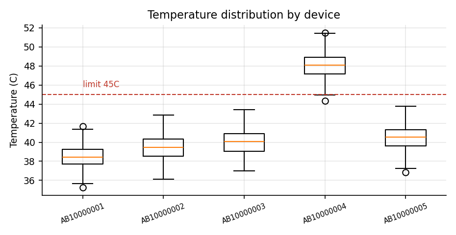
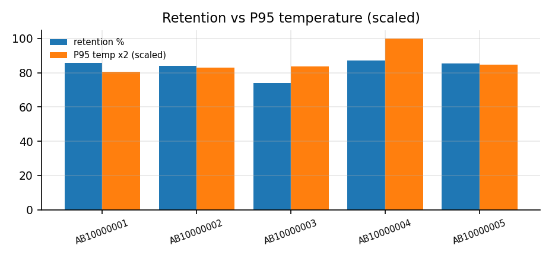

# 可靠性试验数据分析报告

- 生成时间：2026-11-16 14:09
- 数据来源：`data/sample/battery_cycles.csv`
- 原始记录 2500 条，清洗后 2497 条，剔除 3 条

## 一、结论

- 受试设备 **5** 台，通过 **3** 台，未通过 **2** 台，通过率 **60.0%**
- 最差容量保持率：**74.11%**（判据 ≥ 80%）
- 最高 P95 温升：**49.96℃**（判据 ≤ 45.0℃）

**未通过设备及原因：**
- `AB10000003`：容量保持率 74.11% 低于 80%
- `AB10000004`：P95 温升 49.96℃ 超过 45.0℃

## 二、明细

| SN | 循环数 | 初始容量 | 末次容量 | 容量保持率 | P95 温升 | 最高温升 | 容量判定 | 温升判定 | 结论 |
|---|---|---|---|---|---|---|---|---|---|
| AB10000001 | 500 | 500.1 | 429.7 | 85.92% | 40.27℃ | 41.69℃ | PASS | PASS | PASS |
| AB10000002 | 500 | 500.3 | 419.9 | 83.94% | 41.42℃ | 42.85℃ | PASS | PASS | PASS |
| AB10000003 | 500 | 499.6 | 370.3 | 74.11% | 41.87℃ | 43.44℃ | **FAIL** | PASS | **FAIL** |
| AB10000004 | 500 | 503.9 | 439.7 | 87.26% | 49.96℃ | 51.5℃ | PASS | **FAIL** | **FAIL** |
| AB10000005 | 500 | 495.8 | 423.8 | 85.48% | 42.33℃ | 43.76℃ | PASS | PASS | PASS |

## 三、图表

## 四、数据质量问题

共剔除 3 条，明细：
- 关键字段缺失：2 条
- 超出传感器量程：1 条

> 清洗规则说明：缺失与超量程记录一律剔除并计数，不做插补——
> 插补会让「看起来通过」的风险变高，测试报告应如实反映数据缺失。
